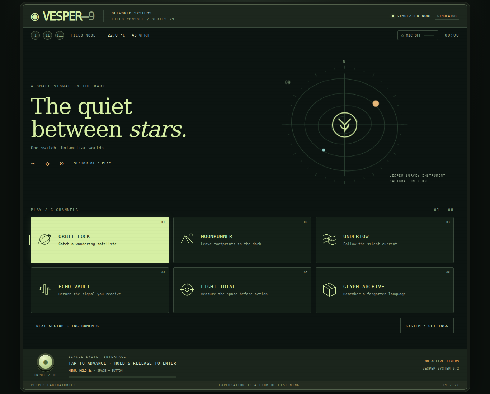

# VESPER—9

> Current Pi trial: [High Bar momentum and corrected controls](docs/HIGH-BAR.md)
> on `codex/highbar-momentum`, plus [CAIRN](docs/CAIRN.md), a difficult fixed climb.
> Release `0c1bf13` was deployed and source-verified on 2026-10-03 at 22:11 UTC.
> Latest saves were copied; `b14db57` and its data remain the rollback. Physical playtesting is next.

> Previous High Bar follow-up (deployed earlier on 2026-10-03): [a skateboarding spider, faster kicks, taller routes and a quieter screen](docs/HIGH-BAR.md), with sixteen challenges and four sustained aerial sky routes. Release `b14db57` from `codex/highbar-mastery` is preserved for rollback.
> Finished-node refresh (2026-10-03): [what changed](docs/REFRESH-REPORT.md),
> [candidate/source status](docs/NODE-CONSOLE-CANDIDATE.md), and
> [Pi acceptance/rollback](docs/PI-ACCEPTANCE.md). Release `b14db57` uses a verified copy of the latest `60adf7a` trial saves; that prior release remains preserved for rollback. Physical play acceptance is pending.


**A small signal in the dark.**

Version **0.2.0** — the second implementation pass of a one-button game console for a Raspberry Pi 5 and an ESP32-S3 field node. Imagine a survey terminal built in 1979 by a civilization that took a slightly different route: phosphor green, warm amber, orbital instruments, unfamiliar glyphs, quiet synthesized tones.

See [what changed in 0.2.0](docs/RELEASE-NOTES.md) and [the remaining Pi qualification work](docs/NEXT-STEPS.md).

The project includes a custom 2D engine, a sector dashboard, games and instruments, the Pi service, ESP32 firmware source, a browser simulator, development tools, tests and an expansion example. The current node has one arcade button, four independent RGB lamps, two microphones and a board LED accent. It has no temperature/humidity sensor. Applications are original cartridges, not commercial ROMs.



## Try it immediately

Open **`VESPER-9-Simulator.html`** in a desktop browser. It is self-contained and needs no installation or internet connection. Use **Space** or the circular on-screen button. Click a card for direct access.

On a phone, tablet or Steam Deck, open the published copy at **https://samuelairs.github.io/vesper9/** (rebuilt from `main` by `.github/workflows/pages.yml`). Tap the on-screen button or the game itself; on iOS, Share › Add to Home Screen opens it full screen. Saves stay in that browser and are separate from the Pi's.

An iPhone app is being built from the same page: [VESPER-9 on iPhone](docs/IOS.md) says what is written, what has been checked and what has never run.

| Gesture | Dashboard, instruments and menus | Inside a game |
| --- | --- | --- |
| Short press | Next item | The game's action |
| Generic case tap | Previous item; two deliberate taps go back | The game's optional case action |
| Hold about 0.65 s, then release | Select item | The game's held action |
| **Tap, tap, hold** (two quick taps, then press and hold for about a second) | System menu | System menu |
| Escape on the keyboard, or the PAUSE button | System menu / close menu | Pause menu |

Tap, tap, hold is the same in every game, instrument and on the dashboard. The two taps and the start of the hold reach a game as ordinary presses; when the menu opens, the game puts back anything they changed. Calibration sets how quick the taps must be (quick, standard, relaxed). A plain three-second hold also opens the menu from the dashboard, instruments and menus, silently.

The standalone file simulates the final four-lamp node and board LED, without fictional environmental readings. It does **not** access the ESP32 or perform speech recognition. Its saves stay in that browser. **K** simulates a generic case tap. Optional left/right mode is calibrated separately; generic is the default so comfortable back taps work. The full Pi service supplies real hardware and local speech.

## Install on the Pi

For Sam's existing console, follow [the save-preserving candidate trial](docs/PI-ACCEPTANCE.md) before replacing any source, data or service configuration. A matching main checkout does not identify the source that the service actually runs.

For a fresh installation, use Raspberry Pi OS **64-bit Desktop**, Python 3.10 or newer, Chromium and the node's configured serial link (native USB or COM bridge). Keep this project folder intact.

```bash
cd vesper9
sudo apt update
sudo apt install python3-venv chromium
bash scripts/install-pi.sh
```

That installs the service and downloads the small English speech model. Use `--no-speech` to omit speech. See [the installation guide](docs/INSTALL.md) for serial permissions, the first firmware install, rollback, and troubleshooting.

The final node last reported firmware **0.2.0**, using compatible protocol v1. These application changes do not require flashing. The bundled **0.1.2 prebuilt is for the older three-lamp board**; it is not the current node's deployment image. Any future firmware replacement requires target identification, the correct board profile, a verified full 16 MB backup and a restore command. See [hardware](docs/HARDWARE.md).

Open **http://localhost:8799** on the Pi. Use **System tools → Node Scope** to check the button, all four RGB lamps, board LED and microphone status. No rewiring is part of this refresh.

For desktop simulation with the full service:

```bash
bash scripts/run-simulator.sh
```

For native Windows development and browser tests, use [the Windows testing workflow](docs/TESTING.md). Broad tests and builds belong on the development host, not the battery-powered Pi.

For automatic service startup and a full-screen kiosk at desktop login:

```bash
.venv/bin/python scripts/install-service.py --port /dev/serial/by-id/YOUR_COM_PORT --kiosk
```

## The cartridges

| Game | What you do |
| --- | --- |
| **Orbit Lock** | Catch a satellite as it crosses an increasingly narrow amber gate. |
| **Moonrunner** | Fly a survey sled over the moon's hills before night falls: hold to dive down a slope, let go to fly off the crest, land along a downslope for a perfect slide; six zones, survey orders and unlocks. |
| **Undertow** | Hold to rise, release to sink, and fly through submerged ruins. |
| **Echo Vault** | Learn and answer pulse transmissions with lamp cues and paid replay. |
| **Light Trial** | React to the middle physical light; the ESP32 timestamps the cue and button edge on the same clock. |
| **Glyph Archive** | Remember an inscription, then reconstruct it with an automatically scanning cursor. |
| **High Bar** | A skateboarding spider: build speed, swing through four vertical parks, flip and master sixteen lines, including four upper sky routes; isolated practice. |
| **Ricochet** | Reverse the paddle through increasingly difficult chambers; practice any chamber reached. |
| **Wayfinder** | Explore three expedition regions, manage supplies, research equipment and resume saved routes. |
| **Twinbeat** | Drum through eight original levels; separate calibrated-side and generic/button-assist careers. |

| Instrument | What it provides |
| --- | --- |
| **Signal School** | Guided keying, listening/scanned answers, adaptive review, and progress saved after each answer. |
| **Chronometer** | Custom durations/labels, saved presets, eight persistent timers, pause/resume and background alerts. |
| **Field Notes** | Local dictation, older-note/text paging, selected-session export and explicit start/stop. |
| **The Stacks** | Offline books, saved places, reverse pages, bookmarks and optional auto-turn. |
| **Encyclopedia** | Optional offline Wikipedia archive, saved article positions, links, trails and bookmarks. |
| **Lantern / Cadence** | Four-lamp scenes and previews; metronome, sequencer and persistent timer tools. |
| **Node Scope** | Button state, individual RGB checks, mic meter, transport counters, audio test. |
| **Calibration** | Sound, texture, Morse/scan speed, menu-gesture timing and selection hold. Under SYSTEM TOOLS in the system menu, with Node Scope and Telemetry. |

These are selected cartridges; `vesper/catalog.json` owns the full catalog and sector order. Calibration, Node Scope and Telemetry are under SYSTEM TOOLS. Retired games keep their source and saves without returning to the dashboard. [Game and operator notes](docs/OPERATOR.md) explain the controls and scoring; newer detailed guides are linked from [the refresh report](docs/REFRESH-REPORT.md).

## Voice and sound

Microphone modes are **Off**, **Voice commands**, and **Transcription**. The system starts muted. Enable a mode from the microphone menu using the button.

In command mode, say “computer home,” “computer open morse,” or “computer timer five minutes.” The prefix is part of an exact command grammar, not a separate always-on wake-word service. Dictation never executes commands. When enabled, dictation can continue while you use other apps; the microphone indicator remains visible. Mute through the system menu or stop in Field Notes.

Recognition uses a local Vosk model. No cloud account, API key, or ongoing network connection is required after installation. Only transcript text is stored; audio is not recorded to disk. Optional sound comes from the Pi's configured HDMI/USB audio output. The node itself has no speaker in the supplied hardware list.

## How it is built

- **Browser engine:** dependency-free ES modules, a 960 × 540 Canvas 2D stage, fixed 60 Hz simulation, collision helpers, procedural visuals, synthesized audio, app lifecycle, and a shared input router.
- **Pi service:** Python / aiohttp, WebSocket events, serial transport, local speech, SQLite storage, background timers, and reconnect handling.
- **ESP32 node:** ESP-IDF C firmware with board profiles, button debounce, independent lamp PWM, stereo tap input, explicit audio modes, framed serial protocol, node-clock reaction trials and a host watchdog. The final board has twelve lamp channels and no I²C environmental sensor.
- **Simulator:** the same apps and rendering code with either a Python simulated node or an in-browser device adapter.

[Engine and extension guide](docs/ENGINE.md) · [Protocol](docs/PROTOCOL.md) · [Hardware profile](docs/HARDWARE.md) · [Design system](docs/DESIGN.md)

## Verification and limits

Fresh Windows results, browser journeys and test limitations are in [VALIDATION.md](docs/VALIDATION.md). The current pass does not claim physical-device validation, Pi benchmarks, firmware builds or real speech recognition. It uses simulated input and isolated temporary data; readers were also exercised against a real offline archive.

Progress and scores wait in a bounded browser RAM queue until the service acknowledges them. Keep the tab open during a connection outage. Changed service saves or another controlling tab require an explicit confirmed choice before replacement. Waiting RAM saves cannot survive browser/power loss. Physical tap accuracy, comfort, acoustic false positives, lamp timing and Pi performance remain acceptance checks. Light Trial is not a laboratory-calibrated optical measurement.

[Current validation results](docs/VALIDATION.md) · [Reproduction commands](docs/TESTING.md) · [Third-party notices](THIRD_PARTY.md)

The project is designed for editable installation from this folder. It is not distributed as a standalone Python wheel; the `web/` and model directories are part of the appliance layout.

Original source and procedural artwork: MIT license. See `LICENSE`.
